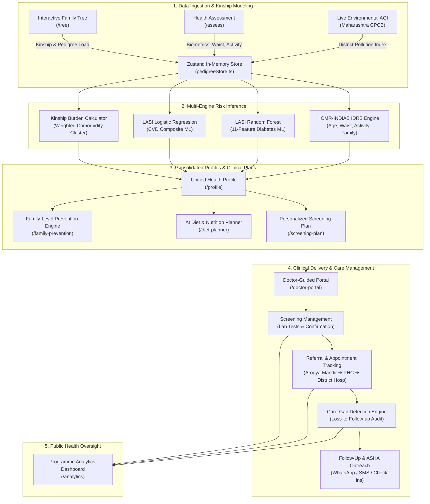
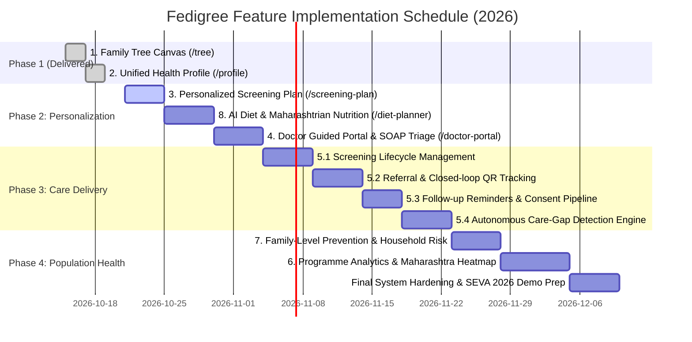

# FeatureList_ImplemntationPlan — Comprehensive Architectural & Implementation Roadmap

> **Platform:** Fedigree — Family Health Tree & NCD Preventive Care Platform for India  
> **Initiative:** SEVA Innovation Challenge 2026 (Maharashtra Zone) • Category 4: Non-Communicable Diseases (NCDs)  
> **Target Alignment:** Ayushman Bharat Digital Mission (ABDM), ICMR-INDIAB, NP-NCD (National Programme for Prevention & Control of NCDs)  
> **Document Version:** 2.0.0  
> **Generated:** October 20, 2026  

---

## 1. Executive Master Feature Matrix

The following master checklist mirrors the system requirements and development status:

| # | Feature Name | Status | Primary Route / Module | Tech Components | Priority |
|---|---|---|---|---|---|
| **1** | **Family Tree** | **Completed** | `/tree` | React Flow (`@xyflow/react`), SVG Avatars, Inspection Drawer, 1-Click Toggles, NSGC Pedigree | Done |
| **2** | **Unified Health Profile** | **Completed** | `/profile` | Multi-engine Composite (IDRS + LASI RF + LASI LogReg + Heredity), Radial Gauges, Action Plan | Done |
| **3** | **Personalized Screening Plan** | **Planned (Sprint 1)** | `/screening-plan` | Clinical Rule Engine, Priority Tiering, Lab Test Catalog, Prep Guide, Printable Rx | Critical |
| **4** | **Doctor Guided** | **Planned (Sprint 2)** | `/doctor-portal`, `/report` | Clinical Triage, SOAP Notes, ICMR/RSSDI Decision Support, Digital Rx & Stamp | High |
| **5** | **Screening, Referrals and Follow-up** | **Planned (Sprint 3)** | `/care-management` | Lifecycle Ledger, QR Referral Tickets, Consent Pipeline, Care-Gap Detection | Critical |
| · | *5.1 Screening Management* | Planned | Sub-module | Eligibility Rules, Lab Result Interpreter, Normal/Abnormal Flagging | Critical |
| · | *5.2 Referral & Appointment Tracking* | Planned | Sub-module | Facility Directory (Arogya Mandir ➔ PHC ➔ CHC ➔ DH), Attendance Tracker | High |
| · | *5.3 Follow-Up & Patient Engagement* | Planned | Sub-module | Automated Multi-channel Reminders (SMS/WhatsApp), Compliance Diary | High |
| · | *5.4 Care-Gap Detection* | Planned | Sub-module | Autonomous Background Audit, Drop-out Risk Scoring, ASHA/CHO Worklist | Critical |
| **6** | **Programme Analytics Dashboard** | **Planned (Sprint 4)** | `/analytics` | Public Health DHO Dashboard, Maharashtra Heatmap, Risk Pyramid, Funnel KPIs | High |
| **7** | **Family Level Prevention** | **Planned (Sprint 4)** | `/family-prevention` | Household Risk Index (HRI), Intergenerational Alerts, Shared Kitchen Swaps | Medium |
| **8** | **AI Diet Generation** | **Planned (Sprint 2)** | `/diet-planner` | BMR/TDEE Calculator, Maharashtrian Millet Substitution Engine, 7-Day Meal Plans | High |

---

## 2. End-to-End System Architecture & Data Flow



---

## 3. Detailed Feature Specifications

### Feature 1: Interactive Family Tree Canvas (COMPLETED)
* **Status:** Operational at `/tree`.
* **Delivered Capabilities:**
  * Native React Flow `@xyflow/react` node-graph engine with dynamic generational tiering (Tier I Grandparents, Tier II Parents, Tier III Proband & Siblings, Tier IV Children).
  * Custom illustrated character avatars (matching regional Indian aesthetics), NSGC clinical pedigree symbols (■ Male, ● Female, ⧄ Deceased, P ↗ Proband).
  * Click-to-inspect slide-over drawer with real-time age steppers, alive/deceased toggles, clinical notes, and 1-click comorbidity toggles (Type 2 Diabetes, Hypertension, CAD Heart Attack, Stroke, Asthma).
  * Real-time calculation of unilateral (+10) and bilateral (+20) parental diabetes risk contribution to the IDRS engine.

---

### Feature 2: Unified Health Profile (COMPLETED)
* **Status:** Operational at `/profile`.
* **Delivered Capabilities:**
  * **Composite Risk Engine (0-100):** Weighted multi-source algorithm consolidating ICMR IDRS (30%), LASI Diabetes Random Forest (25%), LASI CVD Logistic Regression (20%), and 3-Generation Hereditary Kinship Burden (25%).
  * **Visual Diagnostics:** SVG radial progress gauges with 4-tier risk stratification (Emerald Low, Amber Moderate, Orange High, Rose Very High).
  * **Hereditary Comorbidity Lineage:** Kinship-weighted scoring (parents 2.0x, grandparents 1.5x, siblings/children 1.2x) with micro-progress bars across all 5 major NCDs.
  * **Personal Demographics & Environmental Risk:** Complete patient demographic record paired with Maharashtra district AQI impact scoring.
  * **Action Plan & Export:** Trilingual clinical recommendations (English, Marathi, Hindi) with one-click PDF printing.

---

### Feature 3: Personalized Screening Plan (`/screening-plan`)
* **Objective:** Automatically transform multi-engine risk outputs into a structured, individualized clinical diagnostic roadmap.
* **Target Users:** Patients, Community Health Officers (CHOs), ASHA workers, PHC Medical Officers.
* **Core Modules & Specifications:**
  1. **Algorithmic Screening Prescription Engine:**
     * Evaluates Age, Gender, Waist-to-Height Ratio, IDRS Risk Score, ML Probability, and Family History.
     * Categorizes diagnostic tests into 3 urgency tiers:
       * **Tier 1 (Urgent / Within 14 Days):** For IDRS ≥ 60, ML Diabetes > 55%, or bilateral parental T2D. Recommended tests: Fasting Plasma Glucose (FPG), HbA1c, Resting Blood Pressure (serial 3 readings).
       * **Tier 2 (High Priority / Within 30-45 Days):** For ML CVD > 40% or family history of premature CAD (<55y). Recommended tests: Fasting Lipid Profile (TC, TG, HDL, LDL, Non-HDL), 12-lead resting ECG.
       * **Tier 3 (Routine Maintenance / Annual or 3-Yearly):** For low-risk cohorts (<30 IDRS). Basic metabolic panel, annual waist and BMI tracking.
  2. **Diagnostic Test Preparation Guide:**
     * Trilingual step-by-step preparation instructions:
       * *Fasting protocol:* 10-12 hours overnight fasting (water allowed).
       * *Medication pause:* Instructions on morning BP/metformin doses prior to blood draw.
       * *Physiological preparation:* No vigorous cardio 24 hours prior to lipid/glucose draw; 5 minutes seated rest before BP measurement.
  3. **Interactive Test Progress Checklist:**
     * Patient-facing checklist allowing users to check off completed tests and input test results (e.g., FPG: 112 mg/dL, HbA1c: 6.2%).
  4. **Printable / Downloadable Clinical Requisition:**
     * Clean, printable 1-page laboratory requisition slip compatible with Ayushman Bharat PHC diagnostic centers.

---

### Feature 4: Doctor-Guided Mode (`/doctor-portal` & Enhanced `/report`)
* **Objective:** Streamline outpatient triage for government PHC Medical Officers and private general practitioners during rapid 2-minute OPD consultations.
* **Core Modules & Specifications:**
  1. **Clinical Triage Dashboard:**
     * High-density, clutter-free summary displaying patient's 3-generation pedigree flags, IDRS risk breakdown, and calibrated ML probabilities.
     * **Doctor Risk Override:** Allows the physician to confirm, elevate, or downgrade the automated risk score based on physical examination (e.g., presence of Acanthosis Nigricans, pedal edema, or retinopathy).
  2. **ICMR & RSSDI Guidelines Decision Support System (CDSS):**
     * Instant evidence-based recommendations based on patient profile:
       * *Prediabetes (HbA1c 5.7–6.4% or IDRS ≥60):* Intensive lifestyle intervention + Metformin consideration if BMI ≥ 25 or age < 60.
       * *Hypertension + Diabetes:* First-line ACE inhibitor or ARB (Angiotensin Receptor Blocker) to protect renal function.
       * *High Dyslipidemia (TG/HDL ratio > 3.0):* Statin therapy indication flag per Indian lipid guidelines.
  3. **SOAP Clinical Documentation Editor:**
     * **Subjective:** Document presenting complaints (polyuria, polydipsia, fatigue, chest discomfort).
     * **Objective:** Vitals recording (BP, Pulse, Waist, BMI, SpO2) and uploaded lab markers.
     * **Assessment:** Clinical ICD-10 coding (`E11` Type 2 Diabetes, `I10` Essential Hypertension, `E78` Dyslipidemia).
     * **Plan:** Prescribed lifestyle changes, pharmacological regimen, and referral routing.
  4. **Certified OPD Clinical Export:**
     * Formal prescription header with Medical Officer's Name, Registration Number, Clinic/PHC Stamp, and digital signature container.

---

### Feature 5: Screening, Referrals and Follow-Up (`/care-management`)
* **Objective:** Close the loop between risk identification, confirmatory diagnosis, specialist medical care, and continuous patient adherence.

#### 5.1 Screening Management
* **Eligibility Engine:** Evaluates individual and family members against national NP-NCD guidelines (e.g., universal screening for all individuals age ≥ 30).
* **Test Lifecycle State Machine:**
  $$\text{Eligible} \xrightarrow{\text{Prescribe}} \text{Scheduled} \xrightarrow{\text{Sample}} \text{In Lab} \xrightarrow{\text{Result}} \text{Abnormal Flag} \xrightarrow{\text{Confirmation}} \text{Enrolled in Care}$$
* **Diagnostic Interpretation Module:**
  * Auto-classifies lab results:
    * *FPG:* Normal (<100 mg/dL), Impaired Fasting Glucose (100–125 mg/dL), Diabetic (≥126 mg/dL).
    * *HbA1c:* Normal (<5.7%), Prediabetes (5.7–6.4%), Diabetes (≥6.5%), Poor Control (≥8.0%).
    * *Blood Pressure:* Normal (<120/80), Prehypertension (120–139/80–89), Stage 1 HTN (140–159/90–99), Stage 2 HTN (≥160/100).

#### 5.2 Referral & Appointment Tracking
* **Public Health Facility Network Directory:**
  * Hierarchical facility routing across Maharashtra:
    $$\text{Ayushman Arogya Mandir (Sub-Centre)} \rightarrow \text{Primary Health Centre (PHC)} \rightarrow \text{Community Health Centre (CHC)} \rightarrow \text{District Civil Hospital} \rightarrow \text{Tertiary Teaching Hospital}$$
* **Specialist Department Mapping:**
  * Internal Medicine / Diabetology (glycemic management).
  * Cardiology (abnormal ECG, chest pain, high CVD score).
  * Ophthalmology (annual dilated fundus exam for diabetic retinopathy).
  * Nephrology (microalbuminuria, eGFR < 60 mL/min).
* **Digital Referral Token (QR Slip):**
  * Generates an encrypted QR code containing patient triage summary, reason for referral, and preliminary risk stratification.
* **Closed-Loop Attendance Tracking:**
  * Facility intake desk scans token to record status: `Referral Issued` ➔ `Appointment Scheduled` ➔ `Patient Reached Facility (Attended)` ➔ `Consultation Completed` ➔ `Counter-Referral Advice Received`.

#### 5.3 Follow-Up and Patient Engagement
* **Multi-Cadence Automated Schedule:**
  * *High Risk (IDRS ≥60):* Follow-up check at 14 days, 30 days, and 90 days.
  * *Confirmed Diabetics:* Quarterly HbA1c tracking and monthly BP/sugar log.
  * *Moderate Risk:* Semi-annual reassessment.
* **Patient Consent Pipeline:**
  * Explicit opt-in consent capture (DPDP Act 2023 compliant) for communication channels: WhatsApp notifications, SMS text reminders, or ASHA home visits.
* **Patient Health Diary:**
  * Lightweight self-monitoring module for patients to log weekly fasting sugars, home blood pressure, and walking minutes.

#### 5.4 Care-Gap Detection Engine
* **Autonomous Gap Scanning Algorithm:**
  * Continuous background evaluator flagging care lapses:
    * **Gap Type A (Unscreened High Risk):** Patient scored IDRS ≥60 or High ML Risk > 30 days ago, but has no recorded screening test.
    * **Gap Type B (Pending Confirmation):** Screening blood test indicated elevated glucose (FPG ≥ 126), but no confirmatory HbA1c or doctor visit logged within 14 days.
    * **Gap Type C (Broken Referral):** Specialist referral issued > 21 days ago, but patient has not reached the higher facility (`Attended = false`).
    * **Gap Type D (Treatment Drop-out):** Diagnosed patient overdue for quarterly check-up by > 45 days.
* **ASHA / ANM Task Worklist:**
  * Action-oriented prioritized dashboard for frontline workers with direct 1-click actions: "Call Patient", "Schedule Home Visit", "Issue WhatsApp Reminder".

---

### Feature 6: Programme Analytics Dashboard (`/analytics`)
* **Objective:** Enable District Health Officers (DHO), Civil Surgeons, and State NCD Program Directors to monitor population health metrics, resource allocation, and screening coverage.
* **Core Modules & Specifications:**
  1. **Top-Level KPI Metrics Banner:**
     * Total Enrolled Population across districts.
     * Universal Screening Coverage (% of eligible population screened).
     * High-Risk Population Identified (% IDRS ≥ 60).
     * Referral Adherence Rate (% of referrals successfully reaching destination facility).
     * Total Care Gaps Active & Resolution Velocity.
  2. **Maharashtra District Risk & Prevalence Heatmap:**
     * Choropleth geospatial map covering all 36 Maharashtra districts (Pune, Mumbai Suburban, Thane, Nagpur, Nashik, Chhatrapati Sambhajinagar, Kolhapur, Solapur, Amravati, Nanded, etc.).
     * Switchable map layers: *Diabetes Risk Density*, *Hypertension Prevalence*, *AQI Exposure Severity*, *Screening Gap Rate*.
  3. **Population Risk Stratification Pyramid:**
     * Interactive visual pyramid showing distribution from Healthy/Low Risk (Base) to Confirmed Comorbid Multi-Condition Patients (Apex).
  4. **The Screening-to-Care Clinical Funnel:**
     * Step-wise drop-off visualization:
       $$\text{Eligible} \xrightarrow{88\%} \text{Assessed} \xrightarrow{34\%} \text{High-Risk Flagged} \xrightarrow{72\%} \text{Lab Screened} \xrightarrow{81\%} \text{Doctor Consulted} \xrightarrow{68\%} \text{Controlled In Care}$$
  5. **Demographic Equity & Socioeconomic Disparity Insights:**
     * Comparative breakdowns: Urban vs Rural incidence; Gender differences in visceral adiposity; MPCE economic quintile correlation with NCD risk.

---

### Feature 7: Family-Level Prevention (`/family-prevention`)
* **Objective:** Shift NCD prevention from isolated individual treatment to holistic household-level behavioral change.
* **Core Modules & Specifications:**
  1. **Household Risk Index (HRI):**
     * Composite calculation combining:
       * *Genetic Vulnerability:* Cumulative multi-generation comorbidity burden.
       * *Shared Nutritional Risk:* Household cooking oil consumption per capita, polished white rice dependency, packaged snack frequency.
       * *Environmental Load:* Local district outdoor AQI combined with indoor cooking fuel type (LPG vs biomass/chulha).
  2. **Generational Ripple-Effect Early Alerts:**
     * Automated cascade triggers:
       * When a parent is diagnosed with diabetes at age 52, offspring nodes automatically receive an early-screening prompt: *"Due to parental early-onset diabetes, your recommended universal screening age shifts from age 30 to age 20."*
  3. **Family Wellness Quests & Collaborative Goals:**
     * Gamified family micro-challenges designed for Indian households:
       * *Millet Swap Quest:* Replace dinner rice with Jowar/Bajra bhakri 5 days this week.
       * *Salt Shaker Removal:* Remove external salt from dining table to cut sodium intake by 1.5g/day.
       * *Family Post-Meal Stroll:* 15-minute shared walk after dinner (shown to reduce postprandial glucose spike by 22%).
  4. **Household Grocery & Pantry Optimization:**
     * Practical kitchen pantry swap recommendations for the entire household, balancing budget constraints with metabolic health.

---

### Feature 8: AI Diet & Nutrition Planner (`/diet-planner`)
* **Objective:** Culturally calibrated, precision nutrition engine tailored to Maharashtrian and regional Indian dietary habits.
* **Core Modules & Specifications:**
  1. **Personalized Caloric & Macro Requirement Engine:**
     * Calculates Basal Metabolic Rate (BMR via Mifflin-St Jeor formula) and Total Daily Energy Expenditure (TDEE).
     * Formulates South Asian specific macronutrient ratios:
       * *Complex Carbohydrates:* 50–55% (High dietary fiber ≥ 30g/day, Low Glycemic Index).
       * *Proteins:* 20–25% (1.0–1.2g/kg body weight from pulses, sprouts, paneer, curd, fish).
       * *Healthy Fats:* 20–25% (Saturated fat < 7%, zero industrial trans fats, MUFA/PUFA balance).
  2. **Maharashtrian Cultural Dietary Architecture:**
     * Curated culinary database of traditional foods:
       * *Low-GI Staples:* Jowar Bhakri (ज्वारी भाकरी), Bajra Bhakri (बाजरी भाकरी), Nachni/Ragi Bhakri (नाचणी भाकरी), Broken Wheat Khichdi.
       * *High-Protein Preparations:* Matki Usal (मटकी उसळ), Moong Dal Amti, Chana Usal, Hulga/Kulthi (Horsegram) soup, Sprouted Methi Bhaji.
       * *Oil & Salt Regulation:* Cap daily cooking oil at $\le 20\text{ ml}$ per person/day; rotate peanut, mustard, and sesame oils.
  3. **7-Day Dynamic Meal Plan Generator:**
     * Generates complete daily schedules (Early Morning, Breakfast, Lunch, Evening Snack, Dinner) adjusted for diabetes and hypertension comorbidities.
  4. **Smart Food Swap Engine:**
     * Instant visual food substitution widget:
       * Polished Rice (GI ~73) ➔ Hand-pounded Jowar Bhakri (GI ~52).
       * Potato/Aloo Poha ➔ Vegetable & Sprouted Moong Poha.
       * Fried Sev/Farsan ➔ Roasted Chana (फुटाणे) or Roasted Makhana.

---

## 4. Database & State Store Schema Architecture

### Zustand Store Extension (`frontend/src/store/pedigreeStore.ts`)

```typescript
// Extended Data Models for Fedigree Platform

export interface ScreeningTest {
  id: string;
  patientId: string;
  testType: "fpg" | "hba1c" | "lipid_profile" | "bp_serial" | "ecg" | "uacr";
  status: "eligible" | "prescribed" | "sample_collected" | "completed" | "cancelled";
  urgency: "urgent" | "high" | "routine";
  dueDate: string;
  completedDate?: string;
  numericResult?: number;
  unit?: string;
  interpretation?: "normal" | "borderline" | "abnormal" | "critical";
  notes?: string;
}

export interface ReferralRecord {
  id: string;
  patientId: string;
  sourceFacility: string;
  targetFacility: string;
  targetSpecialty: "internal_medicine" | "cardiology" | "ophthalmology" | "nephrology";
  reasonForReferral: string;
  qrToken: string;
  status: "issued" | "scheduled" | "attended" | "completed" | "no_show";
  referralDate: string;
  appointmentDate?: string;
  attendedDate?: string;
  doctorNotes?: string;
}

export interface CareGap {
  id: string;
  patientId: string;
  patientName: string;
  gapType: "unscreened_high_risk" | "pending_confirmation" | "broken_referral" | "treatment_drop_out";
  severity: "critical" | "high" | "medium";
  daysOverdue: number;
  assignedAshaId?: string;
  actionRequired: string;
  status: "open" | "contacted" | "resolved" | "dismissed";
}

export interface HouseholdPreventionProfile {
  familyId: string;
  householdRiskIndex: number; // 0-100
  sharedCookingOilMlPerDay: number;
  cookingFuelType: "lpg" | "piped_gas" | "biomass_chulha";
  primaryGrainStaple: "polished_rice" | "wheat" | "jowar_bajra_millets";
  activeFamilyChallenges: {
    id: string;
    title: string;
    targetDays: number;
    completedDays: number;
    isCompleted: boolean;
  }[];
}
```

---

## 5. Technical Implementation Sprints & Roadmap



---

## 6. Execution Specifications by Sprint

### Sprint 1: Personalized Screening Plan (`/screening-plan`)
* **Target Delivery:** 4 Working Days
* **Deliverables:**
  * Implement route `frontend/src/app/screening-plan/page.tsx`.
  * Create `screeningEngine.ts` mapping (IDRS score, LASI ML probabilities, and comorbidity flags) to specific diagnostic lab tests.
  * Construct Priority Tier grouping cards (Tier 1 Urgent, Tier 2 Moderate, Tier 3 Routine).
  * Build pre-test patient prep drawer (fasting, medication timing).
  * Integrate printable clinical requisition card.
  * Add navigation link with `CalendarClock` icon and trilingual translations (EN, MR, HI).

### Sprint 2: AI Diet Planner & Doctor Guided Portal
* **Target Delivery:** 7 Working Days
* **Deliverables:**
  * Implement route `frontend/src/app/diet-planner/page.tsx` with caloric/macronutrient breakdown, Maharashtrian cultural substitutions, and 7-day meal planner.
  * Enhance `/report` into full `frontend/src/app/doctor-portal/page.tsx` featuring clinical risk validation, SOAP notes editor, RSSDI/ICMR decision support rules, and digital signature stamp.

### Sprint 3: Complete Screening, Referrals & Follow-Up Lifecycle
* **Target Delivery:** 12 Working Days
* **Deliverables:**
  * Implement route `frontend/src/app/care-management/page.tsx` with 4 sub-tabs:
    1. *Screening Registry & Test Tracker*
    2. *Referral Routing & Digital QR Slip Generator*
    3. *Patient Follow-up & Notification Consent*
    4. *Autonomous Care-Gap Detection & ASHA Worklist*
  * Extend `pedigreeStore.ts` with test records, referrals, and care gaps.

### Sprint 4: Family-Level Prevention & Programme Analytics
* **Target Delivery:** 10 Working Days
* **Deliverables:**
  * Implement route `frontend/src/app/family-prevention/page.tsx` with Household Risk Index, generational ripple-effect alerts, and family challenges.
  * Implement route `frontend/src/app/analytics/page.tsx` with Maharashtra district heatmap, population risk pyramid, screening funnel analytics, and public health KPI dashboards.

---

## 7. Standards, Compliance & Quality Assurance

1. **Clinical & Regulatory Alignment:**
   * **ICMR-INDIAB:** Validated Indian Diabetes Risk Score (IDRS) cutoffs ($\ge 60$ high risk).
   * **RSSDI & ICMR Guidelines 2024:** First-line screening and pharmacological thresholds for Indian phenotypes.
   * **ABDM (Ayushman Bharat Digital Mission):** FHIR/HL7 standard field naming for diagnostic lab tests and referral slips.
   * **DPDP Act 2023 (Digital Personal Data Protection):** Explicit patient consent tracking for communications and family health data sharing.
2. **Technical & UI/UX Standards:**
   * Next.js 16 Webpack build compliance (zero Turbopack PostCSS collision).
   * Pure trilingual localization across all user-facing interfaces (English, Marathi, Hindi).
   * Strict TypeScript typing (`noEmit` zero error tolerance) and ESLint clean execution.
   * Offline-first capability with instant client-side fallback engines.
