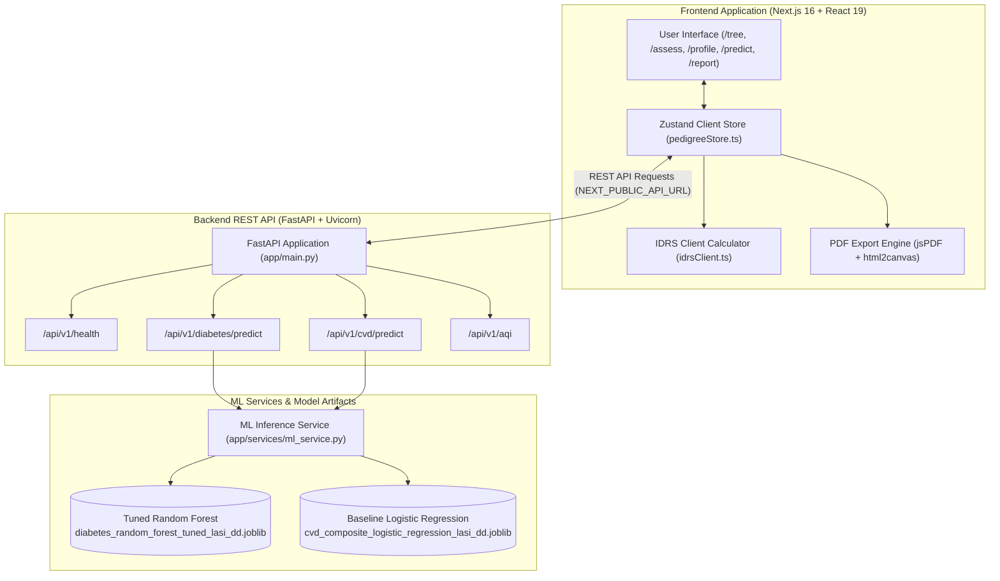

# Fedigree

> **Family Health Tree & NCD Preventive Care Platform for India**  
> Connecting generational health history with clinical risk scores and non-invasive screening to support early prevention of Non-Communicable Diseases (NCDs).

[](https://nextjs.org/)
[](https://react.dev/)
[](https://www.typescriptlang.org/)
[](https://tailwindcss.com/)
[](https://fastapi.tiangolo.com/)
[](https://www.python.org/)
[](https://opensource.org/licenses/ISC)

---

## Table of Contents

1. [About Fedigree](#1-about-fedigree)
2. [Problem Statement](#2-problem-statement)
3. [Project Vision](#3-project-vision)
4. [Key Features](#4-key-features)
5. [Screenshots](#5-screenshots)
6. [Technology Stack](#6-technology-stack)
7. [System Architecture](#7-system-architecture)
8. [Experimental ML Models](#8-experimental-ml-models)
9. [Installation and Setup](#9-installation-and-setup)
10. [Project Structure](#10-project-structure)
11. [Documentation](#11-documentation)
12. [Roadmap](#12-roadmap)
13. [Disclaimer](#13-disclaimer)

---

## 1. About Fedigree

**Fedigree** is an India-focused preventive healthcare and digital health platform designed to help individuals, families, and healthcare providers identify, map, and mitigate risks of chronic Non-Communicable Diseases (NCDs) before clinical complications occur.

Inspired by clinical pedigree charting standards and tailored to Indian demographic realities, Fedigree bridges the gap between family health history and timely medical consultation by integrating:
- **Interactive 3-Generation Pedigree Mapping:** A dynamic family health tree canvas capturing multi-generational biological relationships and chronic disease clustering.
- **ICMR-INDIAB Validated Risk Scoring:** Instant computation of the Indian Diabetes Risk Score (IDRS), developed by MDRF and validated across Indian cohorts by the Indian Council of Medical Research.
- **Environmental Context:** Live district-level Maharashtra Air Quality Index (AQI) tracking to account for environmental contributors to chronic respiratory and cardiometabolic conditions.
- **Experimental Machine Learning Classifiers:** Exploration of regional survey patterns trained on Longitudinal Ageing Study in India (LASI Wave 1) data.
- **1-Page Doctor OPD Triage Brief:** A concise, printable clinical consultation brief designed for rapid 2-minute OPD consultations at Primary Health Centres (PHCs) and clinics.
- **Trilingual Localization:** Built-in runtime language support in English, Marathi (मराठी), and Hindi (हिंदी).

---

## 2. Problem Statement

### The Family Health History Gap in India
Family medical histories in India are predominantly fragmented across scattered physical paper reports, disparate hospital files, and informal oral recollections. When consulting doctors at crowded outpatient departments (OPDs), patients rarely possess an organized, verifiable summary of their multi-generational health background. Consequently, critical familial clusters of premature coronary artery disease, early-onset Type 2 diabetes, stroke, and hypertension remain unrecognized until severe end-organ damage or acute emergencies occur.

### The Urgency of Preventive Healthcare & NCD Awareness
Non-Communicable Diseases (NCDs) account for over 60% of all mortality in India. Crucially, conditions such as Type 2 diabetes and hypertension develop silently over years. Population screening programs face resource bottlenecks, while individuals often lack actionable insight into their personal hereditary and lifestyle risk profile. By combining non-invasive risk stratification (such as waist circumference and parental history metrics) with structured family pedigree mapping, individuals can be guided toward timely diagnostic screening, dietary moderation, and physician consultation at an early, reversible stage.

---

## 3. Project Vision

The long-term vision of Fedigree is to establish an accessible continuum of family-centered preventive healthcare across India. 

Rather than treating health as an isolated individual event, Fedigree aims to:
1. **Empower Families:** Provide households with an intuitive, private, and permanent family health record that can be updated over generations.
2. **Support Frontline Health Workers:** Equip Community Health Officers (CHOs), ASHA workers, and primary healthcare practitioners with rapid non-invasive screening tools to prioritize high-risk families for clinical diagnostic testing.
3. **Align with National Digital Health Ecosystems:** Complement initiatives like the Ayushman Bharat Digital Mission (ABDM), Ayushman Arogya Mandirs (Health & Wellness Centres), and the National Programme for Prevention and Control of Non-Communicable Diseases (NP-NCD).
4. **Shift from Sick-Care to Prevention:** Reduce downstream hospitalization costs and premature disability by fostering early lifestyle intervention and proactive clinical triage.

---

## 4. Key Features

The capabilities of Fedigree are organized into currently implemented features, experimental research modules, and planned roadmap extensions:

### A. Currently Implemented Features (Verified in Codebase)
- **Interactive Family Tree Canvas (`/tree`):**
  - Built with React Flow (`@xyflow/react`) featuring dynamic generational tiering (Grandparents, Parents, Proband & Siblings, Children).
  - Culturally illustrated avatar nodes and clinical pedigree indicators (Male, Female, Deceased, Proband).
  - Slide-over inspection drawer for member details: real-time age adjustments, status toggles, notes, and 1-click comorbidity toggles (Type 2 Diabetes, Hypertension, CAD Heart Disease, Stroke, Asthma).
  - Automated derivation of unilateral (+10) and bilateral (+20) parental diabetes risk contribution directly into the IDRS scoring engine.
- **Clinical Health Assessment (`/assess`):**
  - Deterministic execution of the ICMR-INDIAB Indian Diabetes Risk Score (IDRS) using South Asian waist cutoffs ($<80\text{ cm}$, $80\text{--}89\text{ cm}$, $\ge 90\text{ cm}$) and physical activity weighting.
  - Environmental exposure evaluation incorporating live district-level Maharashtra Air Quality Index (AQI) values and health impact categories.
- **Unified Health Profile (`/profile`):**
  - Demographic and socioeconomic input intake (residency type, MPCE economic quintiles, educational attainment, lifetime tobacco usage) conforming to LASI feature schemas.
  - Visual breakdown of hereditary kinship burden across generations.
- **ML Prediction Test Prototype (`/predict`):**
  - Direct integration with the FastAPI backend to perform model inference for Diabetes and CVD composite classifications.
  - Probabilistic score representation and full diagnostic limitations notices.
  - Client-side offline fallback logic to ensure continuous user evaluation even without an active local backend instance.
- **1-Page Doctor OPD Triage Brief (`/report`):**
  - Formatted clinical brief structured for rapid 2-minute OPD doctor reviews.
  - Embedded pedigree snapshot, patient vitals, IDRS score breakdown, and ICMR-NIN dietary guidance.
  - One-click vector PDF generation and download via `jspdf` and `html2canvas`.
- **Trilingual Localization:**
  - Dynamic in-memory switching between English (`en`), Marathi (`mr`), and Hindi (`hi`) across all navigation items, labels, and clinical recommendations.
- **3D DNA Canvas Background:**
  - Responsive Three.js background animation with DPR normalization and deep plum/lavender aesthetic integration.

### B. Experimental Features (Research Prototypes)
- **LASI Daman & Diu Machine Learning Pipelines:**
  - **Model 1 (Diabetes):** Tuned Random Forest candidate optimized for high sensitivity ($79.41\%$) to classify reported diabetes diagnoses.
  - **Model 2 (CVD Composite):** Baseline Logistic Regression classifier targeting reported hypertension, chronic heart disease, or stroke.
- **Multi-Source Composite Score:**
  - Client-side experimental composite risk indicator synthesizing IDRS scores, ML probabilities, and generational hereditary load.

### C. Upcoming Features (Planned Pipeline)
*As reflected in the platform navigation interface:*
1. **Doctor Guided:** Clinical portal with SOAP clinical notes, physician verification, and prescription generation.
2. **Screening, Referrals and Follow-up:** End-to-end patient referral lifecycle tracking from primary health centers to district hospitals.
3. **Screening Management:** Automated eligibility rules, diagnostic lab catalog, and result interpretation.
4. **Referral and Appointment Tracking:** Geo-aware public facility directory and appointment attendance monitoring.
5. **Follow-Up and Patient Engagement:** Automated multi-channel adherence reminders (SMS / WhatsApp) and compliance diaries.
6. **Care-Gap Detection:** Autonomous audit engine identifying patients overdue for annual screenings or loss-to-follow-up.
7. **Programme Analytics Dashboard:** Public health administrative dashboard displaying district-level epidemiological heatmaps and screening funnels.
8. **Family Level Prevention:** Household Risk Index (HRI) calculations and shared dietary/lifestyle intervention plans.
9. **AI Diet Generation:** Personalized BMR/TDEE calculation and regional Maharashtrian millet-based dietary substitutions based on ICMR-NIN guidelines.

---

## 5. Screenshots

<!-- Screenshots will be added by the team. -->

---

## 6. Technology Stack

Fedigree is built using modern, production-grade web technologies and data science frameworks:

| Layer / Domain | Technology | Purpose & Implementation Details |
|---|---|---|
| **Frontend Framework** | **Next.js 16.4.1 (App Router)** | Server-side rendering, client hydration, and routing architecture. |
| **UI Library** | **React 19.3.0** | Component lifecycle and reactive user interface state. |
| **Language** | **TypeScript 5.x** | Static type checking, strict interface definitions, and compile-time safety. |
| **Styling** | **Tailwind CSS v4** | Modern utility-first design system customized with Fedigree's deep plum and lavender palette. |
| **Graph / Canvas** | **`@xyflow/react` 12.12.0** | Interactive node-based family health tree layout, zoom/pan navigation, and custom node styling. |
| **3D Graphics** | **Three.js 0.186.1** | Animated particle DNA double-helix background canvas. |
| **State Management** | **Zustand 5.0.15** | Lightweight, reactive client-side store managing family nodes, assessment data, and language state. |
| **Document Export** | **jsPDF 4.2.1 & html2canvas 1.4.1** | Client-side generation of the 1-Page Doctor OPD Triage PDF summary. |
| **Icons** | **Lucide React 1.57.0** | Comprehensive clinical, navigational, and status icon set. |
| **Backend API** | **FastAPI >= 0.111** | High-performance Python async REST API serving ML models and health services. |
| **API Server** | **Uvicorn >= 0.29** | ASGI production server for FastAPI. |
| **Data Validation** | **Pydantic >= 2.0 & Pydantic-Settings** | Strict API request and response data schema validation. |
| **Machine Learning** | **Scikit-Learn (1.3 to <2.0)** | ML preprocessing pipelines (imputation, scaling, one-hot encoding) and classification algorithms. |
| **Data Science** | **Pandas & NumPy** | Data wrangling, tabular processing, and numeric vector computations. |
| **Model Serialization**| **Joblib >= 1.3** | Serialization and loading of pre-trained Scikit-Learn pipeline artifacts. |

---

## 7. System Architecture

The architecture of Fedigree utilizes a client-first design capable of running essential risk calculations entirely offline in the browser, complemented by an asynchronous Python backend for statistical model inference and environmental data services:



### Architectural Highlights
1. **Zero-Latency Clinical Calculators:** Standardized clinical algorithms like the ICMR IDRS run deterministically in TypeScript on the client side, ensuring instant feedback without network delays.
2. **Encapsulated ML Pipelines:** All data transformations (numerical median imputation, scaling, categorical one-hot encoding) are encapsulated directly within the saved `joblib` Scikit-Learn pipelines, ensuring exact feature parity between offline training and API inference.
3. **Resilient Offline Architecture:** If the Python backend is unavailable, the frontend gracefully falls back to local client-side evaluation, enabling uninterrupted demonstration and clinical screening.

---

## 8. Experimental ML Models

Fedigree incorporates two experimental machine learning classifiers trained on an authorized extract from the **Longitudinal Ageing Study in India (LASI) Wave 1 (Daman & Diu region)**:

1. **Diabetes Reported-Diagnosis Classifier:**
   - **Selected Algorithm:** Tuned Random Forest (`models/diabetes_random_forest_tuned_lasi_dd.joblib`).
   - **Target (`HT003`):** Self-reported prior diagnosis of diabetes or high blood sugar by a health professional.
   - **Configuration:** Selected with sensitivity-focused tuning ($79.41\%$ sensitivity on hold-out test set; $58.8\%$ reduction in false negatives compared to baseline).
2. **CVD Composite Classifier:**
   - **Selected Algorithm:** Baseline Logistic Regression (`models/cvd_composite_logistic_regression_lasi_dd.joblib`).
   - **Target Composite:** Positive report for any of `HT002` (hypertension), `HT006` (chronic heart disease), or `HT007` (stroke).
   - **Performance:** $73.23\%$ accuracy and $0.7586$ ROC-AUC on hold-out evaluation.

> [!WARNING]
> **Exploratory Status:**  
> These models are trained on a regional survey cohort ($N = 991$ rows; $986$ usable labels). They classify self-reported diagnoses rather than biochemical lab outcomes and are **not clinically validated diagnostic devices**. Model scores represent statistical probabilities, not calibrated individual cardiovascular risk percentages.

For complete technical specifications, dataset audit details, hyperparameter configurations, and evaluation metrics, refer to [`ML_MODEL_README.md`](ML_MODEL_README.md) and [`MODEL_CONTRACT.md`](MODEL_CONTRACT.md).

---

## 9. Installation and Setup

### Prerequisites
- **Node.js:** v18.18+ or v20+ recommended
- **Python:** Python 3.10 or 3.11
- **Package Manager:** `npm` (bundled with Node.js)
- **Git:** Installed and configured

---

### Step 1: Clone the Repository
```bash
git clone https://github.com/KunalPatilCode/Fedigree.git
cd Fedigree
```

---

### Step 2: Backend Setup (FastAPI & ML Inference)

1. Open a terminal in the project root.
2. Create and activate a Python virtual environment:
   ```bash
   # Windows (PowerShell):
   python -m venv venv
   .\venv\Scripts\activate

   # Linux / macOS:
   python3 -m venv venv
   source venv/bin/activate
   ```
3. Install the required Python dependencies:
   ```bash
   pip install -r requirements.txt
   ```
4. Start the FastAPI backend server:
   ```bash
   python backend/run.py
   ```
   *The backend will launch at `http://localhost:8000`. Interactive OpenAPI documentation will be accessible at `http://localhost:8000/docs`.*

---

### Step 3: Frontend Setup (Next.js Application)

1. Open a second terminal and navigate to the `frontend/` directory:
   ```bash
   cd frontend
   ```
2. Install frontend dependencies:
   ```bash
   npm install
   ```
3. *(Optional)* Configure environment variables:
   If your backend is hosted on a non-default port or remote host, create a `frontend/.env.local` file:
   ```env
   NEXT_PUBLIC_API_URL=http://localhost:8000
   ```
   *(If not set, the frontend defaults to `http://localhost:8000` automatically).*
4. Run the frontend development server:
   ```bash
   npm run dev
   ```
5. Open your browser and navigate to:
   ```
   http://localhost:3001
   ```
   *(Or the port specified in your terminal output).*

---

### Step 4: Verification and Smoke Testing
- **Backend Health Check:** Visit `http://localhost:8000/api/v1/health` in your browser. It should return `{"status": "healthy"}`.
- **Frontend Verification:** Navigate to `/tree` to interact with the family canvas, `/assess` to compute an IDRS score, and `/report` to test the Doctor OPD summary generation.

---

## 10. Project Structure

A clean overview of the Fedigree repository layout:

```
Fedigree/
├── README.md                      # Primary project documentation
├── ML_MODEL_README.md             # Comprehensive technical ML model documentation
├── MODEL_CONTRACT.md              # Runtime schema & feature contracts for ML pipelines
├── MODEL_1_DIABETES.md            # Technical specifications for Model 1 (Diabetes)
├── MODEL_2_CVD_COMPOSITE.md       # Technical specifications for Model 2 (CVD Composite)
├── TUNING_SUMMARY.md              # Hyperparameter tuning details and CV trade-offs
├── BACKEND_HANDOVER.md            # Backend API integration and contract guidelines
├── requirements.txt               # Python package dependencies
├── package.json                   # Root workspace scripts and project metadata
├── Procfile                       # Deployment configuration for web dyno
│
├── backend/                       # Python FastAPI Backend
│   ├── run.py                     # Entry point launching Uvicorn on port 8000
│   └── app/
│       ├── main.py                # FastAPI initialization, CORS middleware, router mounting
│       ├── core/
│       │   └── config.py          # Application settings and model path configurations
│       ├── api/endpoints/
│       │   ├── health.py          # Service health check endpoint (/api/v1/health)
│       │   ├── diabetes.py        # Diabetes prediction endpoint (/api/v1/diabetes/predict)
│       │   ├── cvd.py             # CVD composite prediction endpoint (/api/v1/cvd/predict)
│       │   └── aqi.py             # Maharashtra district AQI service (/api/v1/aqi)
│       ├── schemas/               # Pydantic request and response schemas
│       └── services/
│           ├── idrs_service.py    # Python implementation of ICMR IDRS calculation
│           └── ml_service.py      # Joblib artifact loader and pipeline inference execution
│
├── frontend/                      # Next.js 16 Client Application
│   ├── package.json               # Frontend dependencies and Next.js scripts
│   ├── tsconfig.json              # TypeScript compilation settings
│   └── src/
│       ├── app/                   # App Router pages and layouts
│       │   ├── page.tsx           # Landing page with hero, statistics, and triage overview
│       │   ├── layout.tsx         # Global layout with responsive navigation sidebar
│       │   ├── tree/              # Interactive 3-generation family health tree canvas
│       │   ├── assess/            # IDRS health assessment & live Maharashtra AQI calculator
│       │   ├── profile/           # Unified demographic & socioeconomic health profile intake
│       │   ├── predict/           # ML model prediction and probability interface
│       │   └── report/            # 1-Page Doctor OPD Triage brief with vector PDF export
│       ├── components/
│       │   ├── canvas/            # Canvas nodes, drawer modals, and 3D DNA background
│       │   └── layout/            # Desktop sidebar and mobile navigation drawer
│       ├── lib/
│       │   ├── idrsClient.ts      # Pure TypeScript client execution of IDRS algorithm
│       │   └── translations.ts    # Trilingual dictionaries (English, Marathi, Hindi)
│       └── store/
│           └── pedigreeStore.ts   # Zustand global state store
│
├── models/                        # Pre-trained Scikit-Learn pipeline artifacts (.joblib)
│   ├── diabetes_random_forest_tuned_lasi_dd.joblib       # Selected Model 1 (Tuned RF)
│   ├── cvd_composite_logistic_regression_lasi_dd.joblib  # Selected Model 2 (Baseline LogReg)
│   ├── diabetes_random_forest_lasi_dd.joblib             # Comparison Baseline RF
│   ├── diabetes_logistic_regression_lasi_dd.joblib       # Comparison Baseline LogReg
│   └── cvd_composite_random_forest_lasi_dd.joblib        # Comparison Baseline CVD RF
│
├── data/                          # Local data directory (raw survey data excluded)
│   └── README_DATASET.md          # Dataset governance and IIPS access compliance note
│
└── reports/                       # Model evaluation metrics, tuning logs, and data audits
    ├── lasi_daman_diu_model_metrics.csv
    ├── lasi_daman_diu_selected_model_tuning.md
    └── lasi_daman_diu_data_audit.json
```

---

## 11. Documentation

Additional detailed documentation is available across the repository:

- **[ML Model Documentation (`ML_MODEL_README.md`)](ML_MODEL_README.md):** Full scientific report covering dataset audits, hold-out comparisons, sensitivity trade-offs, and safe-use limits.
- **[Model Contract (`MODEL_CONTRACT.md`)](MODEL_CONTRACT.md):** Exact 11-feature Diabetes and 13-feature CVD runtime schemas, input data types, and target definitions.
- **[Model 1 Specifications (`MODEL_1_DIABETES.md`)](MODEL_1_DIABETES.md):** Detailed notes on the LASI Diabetes reported-diagnosis classifier.
- **[Model 2 Specifications (`MODEL_2_CVD_COMPOSITE.md`)](MODEL_2_CVD_COMPOSITE.md):** Detailed notes on the LASI CVD composite classifier.
- **[Tuning Summary (`TUNING_SUMMARY.md`)](TUNING_SUMMARY.md):** Hyperparameter search space, StratifiedKFold CV results, and trade-off analysis.
- **[Backend Handover (`BACKEND_HANDOVER.md`)](BACKEND_HANDOVER.md):** API integration requirements and data protection rules.
- **[Product Concept Document (`Family_Health_NCD_Prevention_Concept.md`)](Family_Health_NCD_Prevention_Concept.md):** Background research on family health history and Indian NCD prevention.
- **[Implementation Roadmap (`FeatureList_ImplemntationPlan.md`)](FeatureList_ImplemntationPlan.md):** Comprehensive multi-sprint architectural plan.

---

## 12. Roadmap

| Phase / Milestone | Status | Description |
|---|---|---|
| **Phase 1: Core Foundation** | **Completed** | 3-Generation interactive pedigree canvas (`/tree`), ICMR IDRS assessment (`/assess`), unified health profile (`/profile`), and trilingual UI support (English, Marathi, Hindi). |
| **Phase 2: Clinical Export & ML Integration** | **Completed** | 1-Page Doctor OPD Triage brief with vector PDF export (`/report`), FastAPI backend integration, and LASI ML prediction testing (`/predict`). |
| **Phase 3: Clinical Care Management** | **Planned (Sprint 1–2)** | Doctor-guided clinical portal with SOAP notes, diagnostic lab test catalog, and personalized screening roadmaps (`/screening-plan`). |
| **Phase 4: Referral & Adherence Network** | **Planned (Sprint 3)** | Public health facility directory (Arogya Mandir $\rightarrow$ PHC $\rightarrow$ District Hospital), referral QR tickets, and automated ASHA follow-up reminders. |
| **Phase 5: Public Health Analytics & AI Nutrition** | **Planned (Sprint 4)** | District health officer programme analytics dashboard (`/analytics`), Household Risk Indexing (`/family-prevention`), and ICMR-NIN compliant AI diet generation. |

---

## 13. Disclaimer

> [!CAUTION]
> ### Clinical and Scientific Disclaimer
>
> 1. **Non-Diagnostic Research Prototype:**  
>    Fedigree is an educational, research, and technical software prototype. It is **not** a certified medical diagnostic device, clinical decision-support software, or treatment recommendation system.
> 
> 2. **No Doctor-Patient Relationship:**  
>    Use of this platform does not establish a doctor-patient relationship. The information, risk scores, and brief summaries generated by Fedigree are intended to encourage informed discussions between individuals and certified medical professionals.
> 
> 3. **Model Prediction Constraints:**  
>    The machine learning models deployed in this prototype are trained on an exploratory regional survey sample from LASI Wave 1 (Daman & Diu). They classify self-reported prior diagnoses and do not predict prospective disease onset or calibrated individual risk percentages. They have not undergone prospective clinical trials or independent external validation.
> 
> 4. **Mandatory Medical Consultation:**  
>    Users must never ignore, delay, or modify professional medical advice or prescribed treatments based on outputs from this application. Anyone experiencing symptoms or concerned about hereditary health risks should seek immediate evaluation from a licensed medical practitioner.
