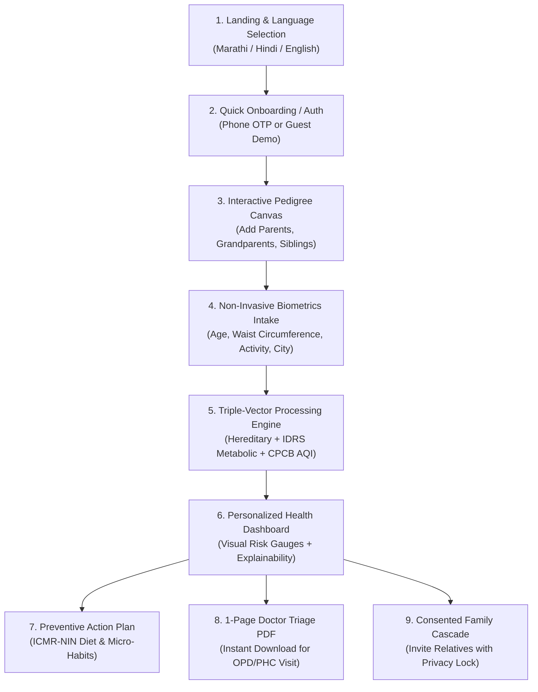
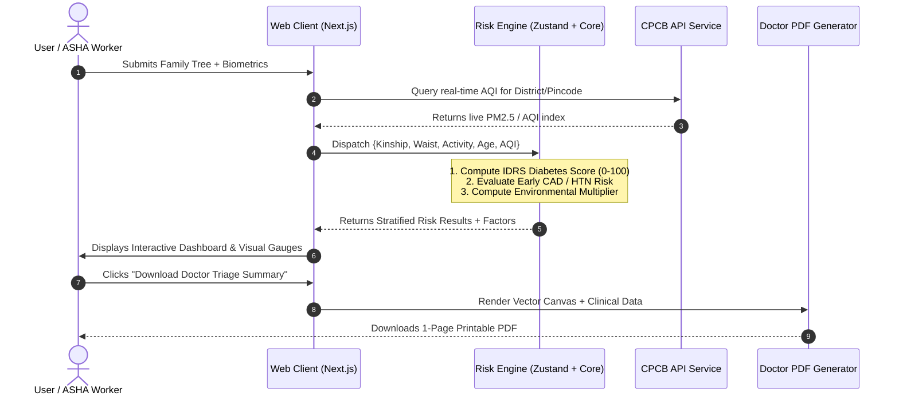
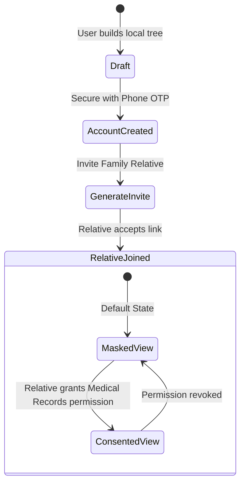

# End-to-End Project Flow: Fedigree

**Project:** Fedigree – Family Health Tree & NCD Preventive Care Platform  
**Competition:** SEVA Innovation Challenge 2026 (Maharashtra Zone)  
**Target:** Category 4 – Non-Communicable and Emerging Lifestyle-Oriented Diseases  
**Branch:** `md`  

---

## 1. High-Level User Journey Overview



---

## 2. Step-by-Step Flow Details

### Step 1: Landing, Localization & Accessibility
* **Entry**: User opens the web app on mobile or desktop.
* **Language Selection**: Immediate toggle between **मराठी (Marathi)**, **हिंदी (Hindi)**, and **English**. The entire interface, clinical prompts, and questionnaires update instantly without reloading.
* **Visual Tone**: Warm, trustworthy, healthcare-grade UI with high contrast and simple visual glyphs.

---

### Step 2: Interactive Family Pedigree Canvas Construction
* **Canvas Initialization**: User starts with their own node ("Self / स्वतः").
* **Adding Relatives**:
  * Tap "+" to add a relative: Father, Mother, Brother, Sister, Maternal/Paternal Grandparents, Children.
  * Standard clinical pedigree iconography (Square = Male, Circle = Female, Diamond = Other/Unspecified).
* **Tagging Medical History**:
  * Assign condition badges per relative:
    - 🔴 **Type 2 Diabetes** (मधुमेह)
    - 🔵 **Hypertension / High BP** (उच्च रक्तदाब)
    - 🟣 **Early Heart Attack / CAD** before age 55 in men or 65 in women (हृदयविकार)
    - 🟢 **Chronic Respiratory Disease / Asthma** (दमा / श्वसनविकार)
* **Immediate Value**: User immediately visualizes multi-generational disease clustering that was previously scattered in memory.

---

### Step 3: Non-Invasive Biometric & Environmental Intake
Designed to be completed in **under 2 minutes** without needles or invasive procedures:
1. **Age & Gender**: Baseline biological demographics.
2. **Waist Circumference (cm / inches)**:
   * Interactive on-screen measuring tape guide highlighting South Asian visceral fat thresholds.
3. **Physical Activity Level**:
   * Vigorous (daily farming, physical labor, intense sports).
   * Moderate (brisk walking, manual housework, cycling).
   * Sedentary (desk work, sitting >6 hours/day with minimal exercise).
4. **Lifestyle Habits**:
   * Tobacco, bidi, gutka, or cigarette usage.
   * Alcohol consumption frequency.
5. **Location Pin Code / District (Maharashtra)**:
   * Selects Pune, Mumbai, Nagpur, Nashik, Chhatrapati Sambhajinagar, etc., to pull live ambient air quality data.

---

### Step 4: Triple-Vector Data Processing Pipeline



---

### Step 5: How Data Is Processed (Clinical Calculation Logic)

The core engine computes risk across **three independent vectors** rather than a single generic percentage:

```mermaid
flowchart LR
    subgraph Vector 1 [Hereditary Vector]
        V1A["Parents with Diabetes<br/>(0, 10, or 20 pts)"]
        V1B["Premature CAD in 1st-degree<br/>(<55 male, <65 female)"]
    end

    subgraph Vector 2 [Metabolic & Lifestyle Vector]
        V2A["Age Bracket (<35, 35-49, >=50)"]
        V2B["Waist Circumference (Indian Cutoffs)"]
        V2C["Physical Activity Level"]
        V2D["Tobacco / Gutka Consumption"]
    end

    subgraph Vector 3 [Environmental Vector]
        V3A["Real-time Ambient AQI (CPCB)"]
        V3B["Indoor Biomass / Chulha Exposure"]
    end

    Vector 1 --> ENGINE["Triple-Vector Clinical Engine"]
    Vector 2 --> ENGINE
    Vector 3 --> ENGINE

    ENGINE --> R1["IDRS Diabetes Risk<br/>Low (<30) | Moderate (30-59) | High (>=60)"]
    ENGINE --> R2["Cardiovascular Vulnerability<br/>Standard | Elevated | Urgent Screening"]
    ENGINE --> R3["Cardiopulmonary Risk Multiplier<br/>Adjusted by PM2.5 Exposure"]
```

---

### Step 6: What the User Receives (Deliverables & Value)

```
┌────────────────────────────────────────────────────────────────────────┐
│                        WHAT THE USER RECEIVES                          │
├─────────────────┬───────────────────┬──────────────────────────────────┤
│ 1. VISUAL RISK  │ 2. PREVENTIVE     │ 3. 1-PAGE DOCTOR                 │
│    DASHBOARD    │    ACTION PLAN    │    TRIAGE SUMMARY                │
│ • Color Gauges  │ • ICMR-NIN Diet   │ • Visual Pedigree Snapshot       │
│ • Score Breakdown│ • Regional Foods │ • Stratified Scores              │
│ • Factor Impact │ • Sleep & Steps   │ • Recommended Lab Test Checklist │
└─────────────────┴───────────────────┴──────────────────────────────────┘
```

1. **Interactive Visual Dashboard**:
   * Clear speedometer gauges for Diabetes and Cardiovascular Risk.
   * Explainable AI (XAI) breakdown: Shows *why* the score is high (e.g., "Waist circumference contributed 30 points; Family history contributed 20 points").
2. **Culturally Contextualized Preventive Plan**:
   * Direct ICMR-NIN dietary substitutions tailored for Maharashtra (e.g., swapping polished white rice with Jowar/Bajra bhakri, limiting cooking oil to 20g/day, increasing pulses/sprouts).
   * Achievable physical activity targets (30-minute daily brisk walking).
3. **1-Page "Doctor-Ready" Triage PDF**:
   * Designed for rapid 2-minute OPD doctor reviews.
   * Contains patient vitals, family tree diagram, computed risk stratifications, and actionable clinical next steps (e.g., *Order Fasting Plasma Glucose + HbA1c + Lipid Profile*).

---

### Step 7: Privacy-Preserving Family Sharing (Consent Architecture)



* **Default (Masked)**: Relatives see the biological relationship and broad category (e.g., "Mother - Type 2 Diabetes"), but cannot view private diagnostic prescriptions, lab values, or personal notes.
* **Authorized (Consented)**: Only when explicitly granted does a family member unlock verified lab reports.
